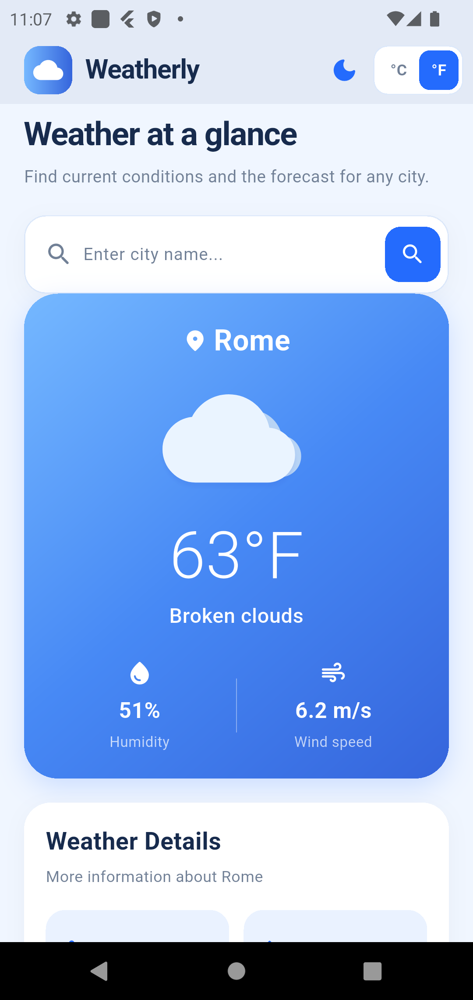
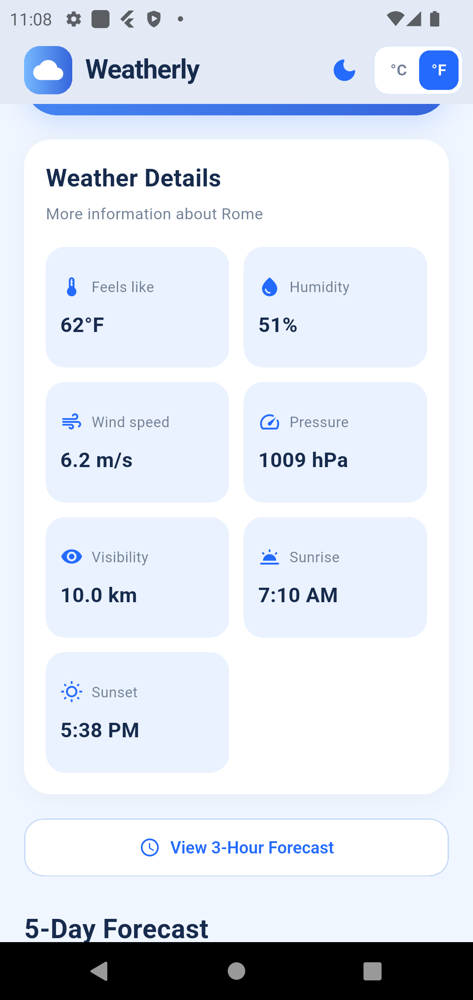
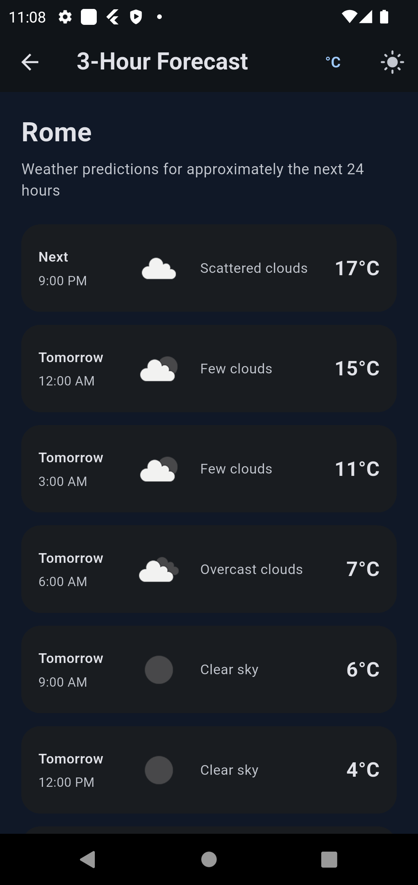
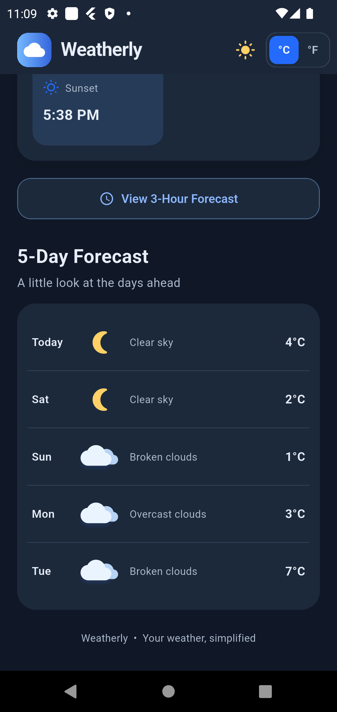
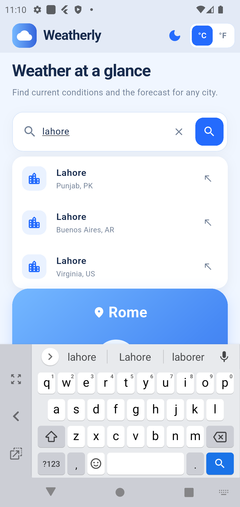
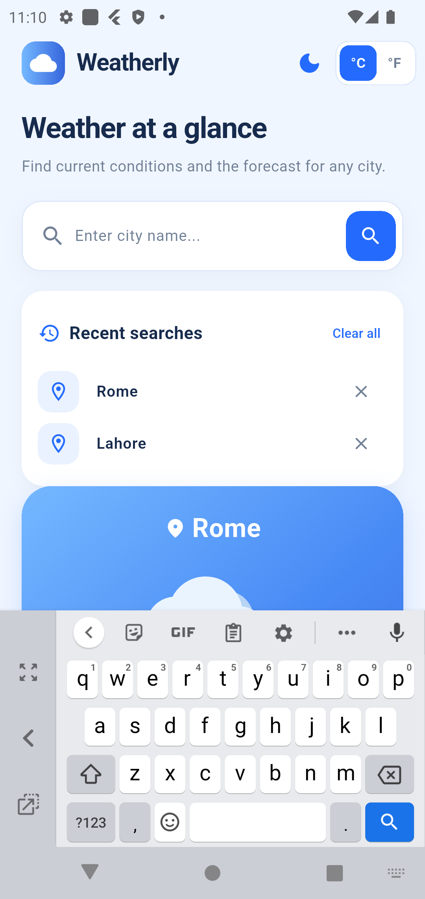

# 🌤️ Weatherly – Weather Forecast App

Weatherly is a Flutter-based weather application that helps users stay updated with current weather conditions and upcoming forecasts. It provides weather information for searched cities through a clean, user-friendly interface.

## 📱 Screenshots

### Main Screen


### Weather Details


### 3-Hour Forecast


### 5-Day Forecast


### Search Suggestions


### Search History


## ✨ Features

- **Current Weather:** Temperature, weather conditions, humidity, and wind speed.
- **3-Hour Forecast:** Upcoming weather conditions at three-hour intervals.
- **5-Day Forecast:** Weather predictions for the next five days.
- **City Search:** Search weather information for different cities.
- **Search Suggestions:** City suggestions while typing.
- **Search History:** Access previously searched cities.
- **Persistent Data:** Remembers the last searched city.
- **Weather Icons:** Weather-specific icons.
- **Error Handling:** Helpful messages for invalid cities, API errors, and connection problems.
- **Responsive UI:** Designed for a smooth mobile experience.

## 🛠️ Technologies Used

- Flutter
- Dart
- OpenWeatherMap API
- HTTP package
- Shared Preferences

## 🌐 API Integration

Weatherly uses the [OpenWeatherMap API](https://openweathermap.org/api) to retrieve current weather and forecast information.

To configure your own API key:

1. Create an account at OpenWeatherMap.
2. Generate an API key.
3. Create `lib/secrets.dart`.
4. Add the following code:

```dart
const String weatherApiKey = 'YOUR_API_KEY_HERE';
```

**Security:** Never upload your actual API key to GitHub.

## 🚀 Getting Started

### Prerequisites

- Flutter SDK
- Dart SDK
- Android Studio
- OpenWeatherMap API key

### Installation

1. Clone this repository:

```bash
git clone https://github.com/nimrasiddiqui193/weather_app.git
```

2. Navigate to the project directory:

```bash
cd weather_app
```

3. Install dependencies:

```bash
flutter pub get
```

4. Create `lib/secrets.dart` and add your API key.

5. Run the application:

```bash
flutter run
```

## 📦 Build APK

Generate a release APK using:

```bash
flutter build apk --release
```

APK location:

```text
build/app/outputs/flutter-apk/app-release.apk
```

## 📂 Project Structure

```text
weather_app/
│
├── assets/
│   ├── icon/
│   └── screenshots/
│
├── lib/
│   ├── models/
│   ├── screens/
│   ├── services/
│   ├── secrets.dart
│   └── main.dart
│
├── android/
├── ios/
├── pubspec.yaml
└── README.md
```

## 🎯 Project Purpose

Weatherly was developed as part of my Flutter development portfolio to demonstrate practical skills in mobile application development, REST API integration, asynchronous programming, data persistence, and user interface development.

---

**Developed with Flutter 💙**

**GitHub:** https://github.com/nimrasiddiqui193